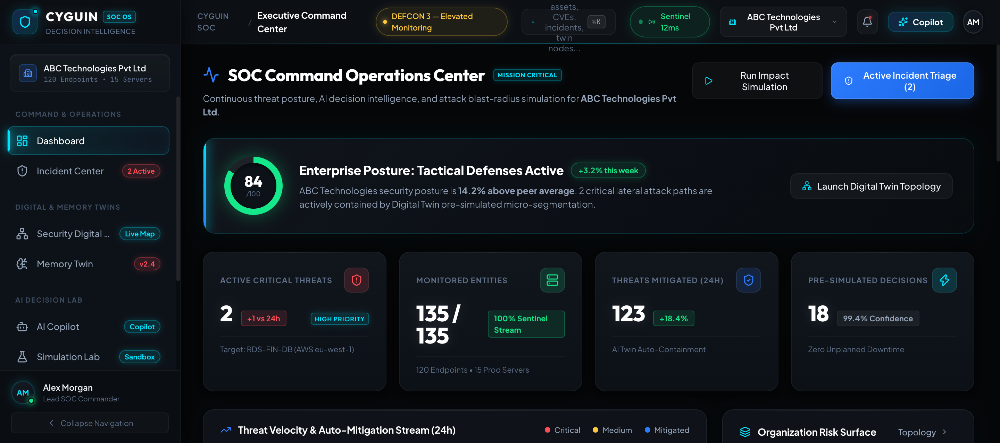
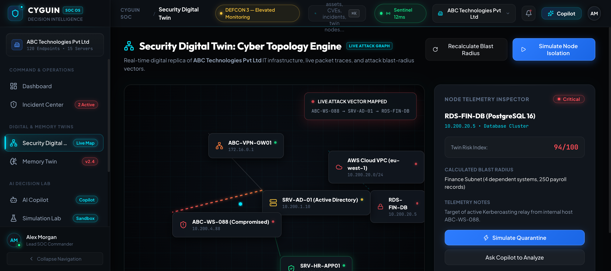
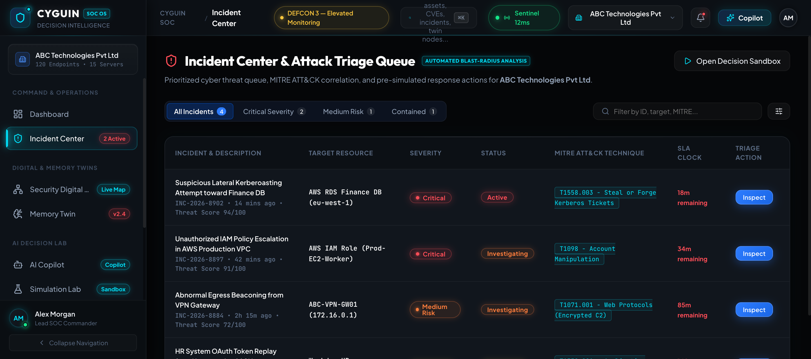
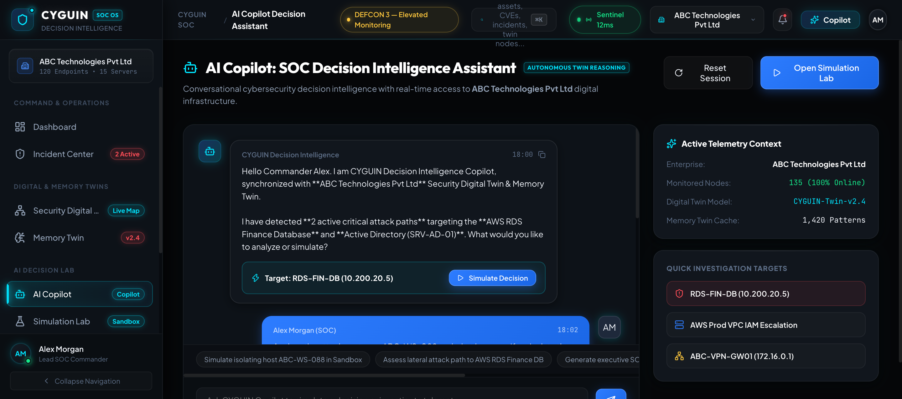
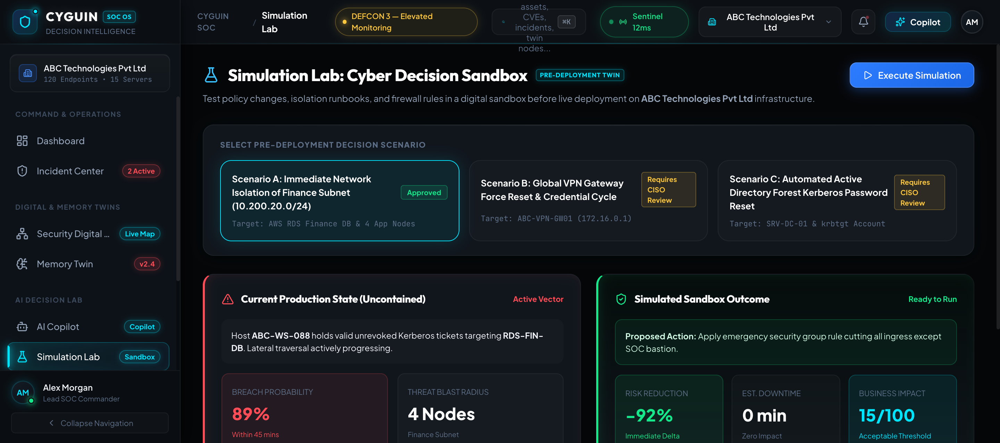
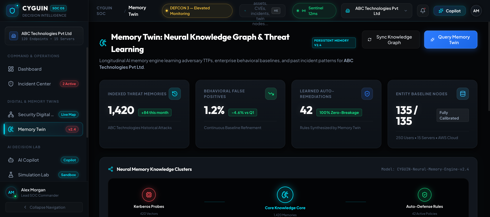
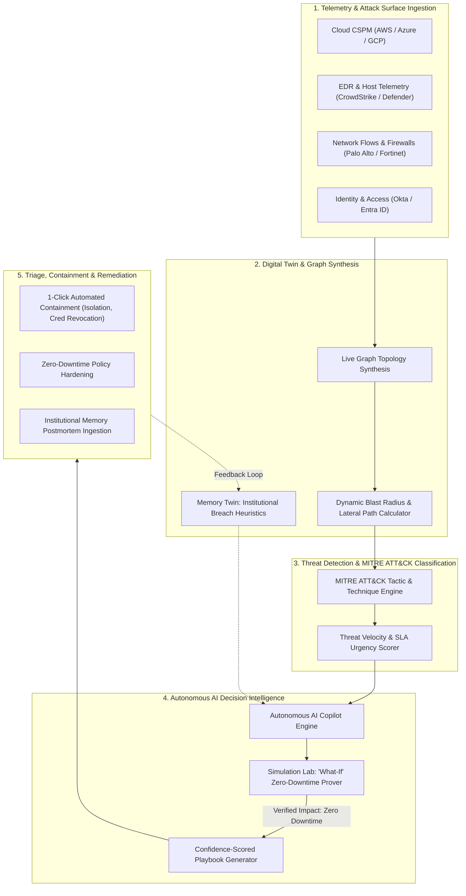

# CYGUIN (サイグイン) 🛡️

<div align="center">


[](https://reactjs.org/)
[](https://www.typescriptlang.org/)
[](https://vitejs.dev/)
[](LICENSE)

**Autonomous AI-Powered Cybersecurity Decision Intelligence & Digital Twin Platform**

*A mission-critical, military-grade Cyber Operating System for modern Security Operations Centers (SOC) and enterprise CISOs.*

[Overview](#-overview) •
[Prototype Showcase](#-prototype-showcase) •
[Operational Workflow](#-operational-workflow) •
[Key Pillars](#-key-pillars) •
[Platform Views](#-platform-views) •
[Architecture](#-architecture--tech-stack) •
[Quick Start](#-quick-start) •
[Design System](#-design-system) •
[Keyboard Shortcuts](#-keyboard-shortcuts)

</div>

---

## 🛰️ Overview

**CYGUIN** is an enterprise-grade cybersecurity decision intelligence platform engineered to eliminate SOC alert fatigue, accelerate incident response, and proactively model threat scenarios before attackers strike.

Drawing inspiration from tier-1 defense platforms (Microsoft Defender XDR, CrowdStrike Falcon, Wiz, Palo Alto Cortex, and Google Chronicle), CYGUIN pairs real-time multi-cloud telemetry with:
- **Interactive Cyber Digital Twins** for instant topology visualization, packet flow tracing, and blast-radius calculation.
- **Memory Twins** that capture institutional knowledge, learned threat heuristics, and countermeasure efficacy over time.
- **Autonomous AI Copilot** delivering verified, confidence-scored containment actions with operational impact guarantees.
- **War-Gaming Simulation Lab** to safely test remediation actions without risking production downtime.

---

## 📸 Prototype Showcase

Explore key modules of the CYGUIN Cyber Operating System prototype in action:

### 1. Executive Security Dashboard & Threat Velocity
High-level security posture overview displaying enterprise risk scores, real-time threat velocity trends, MITRE ATT&CK kill-chain progression, and high-priority incident triage.



---

### 2. Interactive Cyber Digital Twin
Real-time network topology engine modeling relationships between cloud gateways, Kubernetes clusters, databases, and enterprise endpoints with dynamic packet flows and lateral movement blast-radius highlighting.



---

### 3. Incident Command & Forensic Investigation Center
Deep forensic analysis workspace mapping incidents directly to MITRE ATT&CK techniques, calculating active blast radius, displaying SLA timers, and providing 1-click containment triggers.



---

### 4. Autonomous AI Decision Copilot
Context-aware cyber intelligence engine offering natural language security reasoning, automated containment playbook generation, and confidence-scored policy hardening with operational impact guarantees.



---

### 5. "What-If" War-Gaming Simulation Lab
Predictive adversary emulation and policy testing sandbox. Forecasts risk reduction percentage against operational downtime minutes before executing containment commands on production infrastructure.



---

### 6. Memory Twin & Institutional Cyber Knowledge
Institutional memory graph indexing past attack vectors, organizational response histories, and countermeasure success rates to continuously train defensive instincts.



---

## 🔄 Operational Workflow

CYGUIN implements a continuous **Sense → Model → Simulate → Decide → Contain → Learn** closed-loop decision architecture:



### Detailed Operational Lifecycle

```
[ Ingest Telemetry ] ──> [ Synthesize Digital Twin ] ──> [ Correlate MITRE Tactics ]
                                                                   │
                                                                   ▼
[ Update Memory Twin ] <── [ Deploy Containment ] <── [ 'What-If' Pre-Flight Sim ]
```

1. **Telemetry & Attack Surface Ingestion**: Real-time events are continuously ingested across endpoints, multi-cloud platforms, identity providers, and network perimeters.
2. **Digital Twin Graph Synthesis**: Raw telemetry is mapped into an interactive topology graph, identifying critical pathways, dependencies, and potential lateral movement corridors.
3. **MITRE ATT&CK Classification**: Threats are automatically categorized into stages of the cyber kill chain (Initial Access, Execution, Lateral Movement, Exfiltration) with real-time SLA countdowns.
4. **Autonomous AI "What-If" Verification**: Before recommending action, the AI Copilot sends proposed playbooks to the Simulation Lab to verify risk reduction against potential business disruption.
5. **Verified Containment & Policy Hardening**: SOC engineers execute verified countermeasures (e.g., host isolation, credential revocation, micro-segmentation) with a single click.
6. **Continuous Institutional Memory Retention**: Outcomes and resolution metrics feed back into the Memory Twin, optimizing future response confidence scores.

---

## ⚡ Key Pillars

| Pillar | Description |
| :--- | :--- |
| **🌐 Cyber Digital Twin** | Real-time topological replica of hybrid infrastructure (Cloud, On-prem, Identity, Edge). Models packet flow, compromised node elevation, and lateral movement vectors. |
| **🧠 Memory Twin Engine** | Dynamic institutional memory indexing past incident postmortems, attacker heuristics, and proven remediation recipes to prevent repeated breach patterns. |
| **🤖 Autonomous AI Copilot** | Natural language SOC assistant that synthesizes forensic evidence, maps MITRE ATT&CK techniques, and generates step-by-step containment playbooks. |
| **🧪 Simulation Lab ("What-If")** | Safe digital proving ground for testing security policies, firewall rules, and isolation actions against simulated adversary tactics prior to live execution. |
| **🎯 Incident Command Center** | SLA-driven triage pipeline featuring blast-radius inspection, root-cause forensics, and 1-click containment mechanisms. |
| **🛡️ Attack Surface Management** | Continuous asset inventory tracking CVE exposures, telemetry health, agent versions, and critical risk deltas across enterprise nodes. |

---

## 🖥️ Platform Views

CYGUIN features 9 integrated mission modules accessible via persistent navigation and hash-based deep linking:

* **Executive Security Dashboard (`#dashboard`)**: High-velocity posture metrics, Threat Velocity, Active Incident counts, and SLA compliance.
* **Incident Center (`#incident-center`)**: In-depth forensic examination workspace with SLA timers, root-cause diagnostic trees, and affected asset impact matrices.
* **Cyber Digital Twin (`#digital-twin`)**: Dynamic SVG network topology canvas with interactive nodes, packet flow animations, and blast-radius projections.
* **Memory Twin (`#memory-twin`)**: Vector-retrievable repository of past breach incidents and postmortem telemetry benchmarks.
* **Autonomous AI Copilot (`#ai-copilot`)**: Conversational AI decision intelligence fine-tuned for SecOps triage, policy hardening, and automated playbooks.
* **Simulation Lab (`#simulation-lab`)**: "What-If" scenario sandbox modeling financial, operational downtime, and security tradeoffs.
* **Asset Discovery & Inventory (`#assets`)**: Full-spectrum attack surface management (ASM), agent status, and vulnerability CVE density indicators.
* **Executive Reports & Audits (`#reports`)**: Multi-framework compliance reporting (SOC 2 Type II, ISO 27001, NIST CSF, HIPAA) and MTTD/MTTR analytics.
* **System Settings & Connectors (`#settings`)**: SIEM, SOAR, EDR, and Cloud CSPM ingestion configurations, RBAC, and alert threshold tuning.

---

## 🏗️ Architecture & Tech Stack

CYGUIN is built for zero-latency SOC operational velocity, combining a strictly typed frontend architecture with a bespoke, GPU-accelerated design system.

```
PROJECT-CYGUIN/
├── index.html                  # HTML entry point with modern typography preconnects
├── package.json                # Project dependencies & build scripts
├── tsconfig.json               # TypeScript compiler configuration (strict mode)
├── vite.config.ts              # Vite 6 bundler configuration
├── DESIGN.md                   # Mission-Critical Cyber OS Design System tokens
├── docs/
│   └── images/                 # High-resolution prototype screenshots
│       ├── dashboard-view.png
│       ├── digital-twin-view.png
│       ├── incident-center-view.png
│       ├── ai-copilot-view.png
│       ├── simulation-lab-view.png
│       └── memory-twin-view.png
└── src/
    ├── main.tsx                # Application bootstrap
    ├── App.tsx                 # Core layout, global search listener & view routing
    ├── components/
    │   └── common/             # Reusable UI primitives
    │       ├── Header.tsx              # Top navigation, status indicator & quick actions
    │       ├── Sidebar.tsx             # Collapsible tactical navigation bar
    │       ├── GlobalSearchModal.tsx   # ⌘K Omnibar search & command palette
    │       ├── NotificationDrawer.tsx  # Slide-out alert & telemetry stream
    │       ├── MetricCard.tsx          # High-density statistical display cards
    │       ├── StatusBadge.tsx         # Severity & operational state indicators
    │       └── Tabs.tsx                # Multi-tab view switchers
    ├── data/
    │   └── organizationData.ts # Enterprise telemetry, incidents, assets & simulations
    ├── styles/
    │   └── index.css           # Mission-Critical dark-theme CSS design system
    ├── types/
    │   └── index.ts            # Enterprise TypeScript domain definitions
    └── views/                  # Primary platform workspaces
        ├── DashboardView.tsx
        ├── IncidentCenterView.tsx
        ├── DigitalTwinView.tsx
        ├── MemoryTwinView.tsx
        ├── AICopilotView.tsx
        ├── SimulationLabView.tsx
        ├── AssetsView.tsx
        ├── ReportsView.tsx
        └── SettingsView.tsx
```

### Core Technologies

* **Frontend Framework**: [React 18.3](https://react.dev/) + [TypeScript 5.6](https://www.typescriptlang.org/)
* **Build Tooling**: [Vite 6.0](https://vitejs.dev/)
* **Iconography**: [Lucide React](https://lucide.dev/)
* **Typography**:
  * **Headings & Display**: `Outfit`
  * **UI & Body**: `Plus Jakarta Sans`
  * **Telemetry & Hex Dumps**: `JetBrains Mono`
* **Styling**: Pure, lightweight CSS3 custom properties with glassmorphism, hardware-accelerated animations, and zero CSS runtime overhead.

---

## 🚀 Quick Start

### Prerequisites
* **Node.js**: `v18.0.0` or higher (Node 20+ recommended)
* **Package Manager**: `npm`, `yarn`, or `pnpm`

### Installation

1. **Clone the repository:**
   ```bash
   git clone https://github.com/sivasubramaniyan-06/PROJECT-CYGUIN.git
   cd PROJECT-CYGUIN
   ```

2. **Install dependencies:**
   ```bash
   npm install
   ```

3. **Start the development server:**
   ```bash
   npm run dev
   ```

4. **Open in browser:**
   Navigate to `http://localhost:5173` to explore the platform.

### Production Build

To produce an optimized production bundle:
```bash
npm run build
```

To preview the production build locally:
```bash
npm run preview
```

---

## 🎨 Design System

CYGUIN adheres to a strict, high-contrast **Mission-Critical Cyber OS** visual specification documented in [`DESIGN.md`](DESIGN.md):

* **Stealth Canvas (`#050608`)**: Pitch-black root container eliminating eye fatigue during prolonged SOC watch cycles.
* **Surface Containers (`#090C10`, `#11161D`)**: Layered card containers with 1px precision outline borders (`rgba(255, 255, 255, 0.05)`).
* **Electric Cyan (`#00E5FF`)**: Telemetry accent, packet flows, and active AI reasoning indicators.
* **Cyber Blue (`#2D7CFF`)**: Interactive trigger nodes and primary command buttons.
* **Neon Emerald (`#15E88A`)**: Verified secure status, compliant controls, and healthy assets.
* **Vibrant Amber (`#FFC83D`)**: Medium risks, policy drifts, and unpatched CVE notices.
* **Laser Crimson (`#FF4D57`)**: Active compromises, lateral movement alerts, and SLA breach warnings.

---

## ⌨️ Keyboard Shortcuts

| Shortcut | Action | Scope |
| :--- | :--- | :--- |
| <kbd>⌘</kbd> + <kbd>K</kbd> / <kbd>Ctrl</kbd> + <kbd>K</kbd> | Open Global Omnibar Search & Command Palette | Global |
| <kbd>Esc</kbd> | Dismiss active modal / close drawer | Global |
| `#<route-id>` | Deep link directly into any platform view | URL Hash Navigation |

---

## 🛡️ Security & Reliability Principles

* **Zero Production Downtime Guarantee**: All autonomous AI recommendations undergo operational impact estimation before policy dispatch.
* **Defense-in-Depth Observability**: Every view provides multi-layer telemetry cross-referencing host agent health, network flow logs, and identity audit trails.
* **Audit Trail Readiness**: Every containment and simulation action generates timestamped, reproducible incident artifacts.

---

## 📄 License

This project is licensed under the [MIT License](LICENSE) - feel free to use, modify, and distribute for personal or enterprise cybersecurity research.

---

<div align="center">
  <sub>Built with precision for mission-critical Security Operations. <b>CYGUIN Cyber OS</b>.</sub>
</div>
